# Daijo MES - SAP Business One & Webhooks Integration Guide

Panduan arsitektur komprehensif untuk integrasi dua arah antara **PT Daijo Industrial MES** dan **SAP Business One API Gateway**, serta webhook/API eksternal.

---

## 1. Arsitektur Komunikasi Dua Arah

Integrasi antara Daijo MES dan SAP Business One terbagi menjadi dua jalur komunikasi utama:

```mermaid
flowchart TD
    subgraph SAP["SAP Business One Gateway (192.168.6.149:9001)"]
        SAP_AUTH["/auth/token"]
        SAP_REC["/api/receipt_production/create"]
        SAP_TRF["/api/inventory_transfer/create"]
        SAP_SPK["/api/sap_production_order/list"]
        SAP_DELSO["/api/sap_del_so/list"]
        SAP_DELSCH["/api/sap_del_sched/list"]
        SAP_DELACT["/api/sap_del_actual/list"]
        SAP_BOM["/api/sap_bom_wip/list*"]
        SAP_MTR["/api/sap_inventory_mtr/list*"]
        SAP_FG["/api/sap_inventory_fg/list*"]
        SAP_LINE["/api/sap_lineproduction/list*"]
        SAP_RJCT["/api/sap_reject/list"]
    end

    subgraph MES_OUT["MES Outbound Services (app/Services)"]
        BASE["BaseSapService (Gateway, Cache & Lock)"]
        REC_SVC["ReceiptProductionService"]
        QC_SVC["QcTransferService"]
        WMS_SVC["WmsSapSyncService"]
        SPK_SVC["SpkMasterService"]
        DEL_SVCS["DelSo / DelSched / DelActual"]
        INV_SVCS["BomWip / InventoryFg / InventoryMtr / Line / Reject"]
    end

    subgraph MES_IN["MES Inbound Webhooks & Endpoints (routes/api.php)"]
        MW["Middleware: ip.and.apikey + throttle:sap-api"]
        WH_DO["POST /api/sap/do (SOController::storeFromSap)"]
        WH_SPK["POST /api/sap/spk (SOController::storeSpkNew)"]
        WH_ITEM["POST /api/sap/master-list-item (MasterListItemController::storeFromSap)"]
        API_CUST["GET /api/production-status-range (CustomerProductionController::range)"]
    end

    %% Outbound Flows
    BASE -->|POST Credentials| SAP_AUTH
    REC_SVC -->|POST Receipt Box| SAP_REC
    QC_SVC -->|POST Transfer OK/NG| SAP_TRF
    WMS_SVC -->|POST Pallet Move| SAP_TRF
    SPK_SVC -->|GET Orders| SAP_SPK
    DEL_SVCS -->|GET Delivery Data| SAP_DELSO
    DEL_SVCS -->|GET Delivery Schedule| SAP_DELSCH
    DEL_SVCS -->|GET Delivery Actual| SAP_DELACT
    INV_SVCS -->|GET Master Stocks & Routings| SAP_BOM
    INV_SVCS -->|GET Raw Materials| SAP_MTR
    INV_SVCS -->|GET Finished Goods| SAP_FG
    INV_SVCS -->|GET Lines| SAP_LINE
    INV_SVCS -->|GET Rejects| SAP_RJCT

    %% Inbound Flows
    SAP -.->|POST DO Data| MW
    SAP -.->|POST SPK History| MW
    SAP -.->|POST Item Master| MW
    MW --> WH_DO
    MW --> WH_SPK
    MW --> WH_ITEM
```



---

## 2. Outbound Integration (MES ke SAP)

Semua outbound request ke SAP wajib mewarisi [`App\Services\BaseSapService`](file:///home/andreas/projects/Daijo_MES/app/Services/BaseSapService.php).

### 2.1 Mekanisme Gateway & Security
- **Target Gateway URL**: `config('services.sap.base_url')` (default `http://192.168.6.149:9001`)
- **Autentikasi Token (`/auth/token`)**:
  - Request `CompanyDB`, `Username`, dan `Password` dari `config('services.sap.*')`.
  - Token Bearer disimpan di Cache (Redis/DB) dengan TTL **50 menit**.
  - **Cache Stampede Atomic Lock**: Menggunakan `Cache::lock('sap_token_lock', 40)` dengan toleransi antrean 30 detik untuk mencegah multi-request merebut login bersamaan saat cache kedaluwarsa.
  - **Auto-Refresh pada 401**: Jika request mengembalikan `401 Unauthorized`, `BaseSapService` otomatis menghapus cache token, melakukan login ulang, dan mengulang request sebanyak 1x.
- **Timeout & Retries**:
  - Default Timeout: **120 detik** (untuk mengakomodasi laporan volume besar seperti Line Production dan BOM).
  - Connect Timeout: **15 detik**.
  - Retry Strategy: `retry(2, 1000, throw: false)` (2x percobaan dengan backoff 1 detik).
- **Audit Logging**:
  - Semua trafik tercatat di tabel database `api_logs` melalui helper `saveApiLog()`.

### 2.2 Katalog Endpoint Outbound SAP

| No | Service | Endpoint SAP | Metode | Trigger / Jadwal | Tujuan di MES |
|---|---|---|---|---|---|
| 1 | `BaseSapService` | `/auth/token` | `POST` | Lazy load / Token expired | Mendapatkan Bearer token |
| 2 | `ReceiptProductionService` | `/api/receipt_production/create` | `POST` | Scheduler `sap:dispatch-receipt` (setiap 10m) | Menerbitkan bukti penerimaan box selesai produksi (`production_summary`) |
| 3 | `QcTransferService` | `/api/inventory_transfer/create` | `POST` | Manual QC Box Inspection | Memindahkan barang lulus inspeksi ke FG dan reject ke RJCT |
| 4 | `WmsSapSyncService` | `/api/inventory_transfer/create` | `POST` | Pallet Creation / `SapSyncMonitor` | Memindahkan pallet dari gudang produksi `FFI` ke gudang utama `FG` |
| 5 | `SpkMasterService` | `/api/sap_production_order/list` | `GET` | Scheduler `spk:sync` (setiap 10m) | Sinkronisasi status SPK, kuantitas rencana, dan completed ke `spk_masters` & `spk_change_logs` |
| 6 | `DelSoService` | `/api/sap_del_so/list` | `GET` | Scheduler `sync:delivery-data` | Sinkronisasi Sales Order ke `sap_delso` |
| 7 | `DelSchedService` | `/api/sap_del_sched/list` | `GET` | Scheduler `delsched:run` (08:10 & 14:10) & `sync:delivery-data` | Sinkronisasi jadwal pengiriman ke `sap_delsched` |
| 8 | `DelActualService` | `/api/sap_del_actual/list` | `GET` | Scheduler `sync:delivery-data` | Sinkronisasi riwayat aktual kirim ke `sap_delactual` |
| 9 | `BomWipService` | `/api/sap_bom_wip/list*` | `GET` | Scheduler `sync:delivery-data` | Sinkronisasi pohon BOM WIP bertingkat ke `sap_bom_wip` |
| 10 | `InventoryMtrService` | `/api/sap_inventory_mtr/list*` | `GET` | Scheduler `sync:delivery-data` | Sinkronisasi stok material mentah ke `sap_inventory_mtr` |
| 11 | `InventoryFgService` | `/api/sap_inventory_fg/list*` | `GET` | Scheduler `sync:delivery-data` | Sinkronisasi stok barang jadi & parameter mesin ke `sap_inventory_fg` |
| 12 | `LineProductionService`| `/api/sap_lineproduction/list*` | `GET` | Scheduler `sync:delivery-data` | Sinkronisasi prioritas rute mesin ke `sap_lineproduction` |
| 13 | `RejectService` | `/api/sap_reject/list` | `GET` | Scheduler `sync:delivery-data` | Sinkronisasi saldo reject ke `sap_reject` |

---

## 3. Inbound Integration (SAP & Eksternal ke MES Webhook)

Endpoint webhook di MES dikelola di [`routes/api.php`](file:///home/andreas/projects/Daijo_MES/routes/api.php).

### 3.1 Keamanan & Middleware (`ip.and.apikey`)
Semua endpoint webhook dari SAP dilindungi oleh middleware [`App\Http\Middleware\IpAndApiKeyWhitelist`](file:///home/andreas/projects/Daijo_MES/app/Http/Middleware/IpAndApiKeyWhitelist.php) dan rate limiter `throttle:sap-api`:
1. **IP Whitelisting**:
   - Hanya IP SAP yang diizinkan: `192.168.6.1`.
   - Mengembalikan HTTP `403 Forbidden: IP not whitelisted` jika IP tidak cocok.
2. **API Key Authentication**:
   - Header yang divalidasi: `X-API-KEY` (atau fallback query `api_key`).
   - Nilai kunci rahasia diambil dari `config('services.api_secret_key')` / `env('API_SECRET_KEY')`.
   - Mengembalikan HTTP `401 Unauthorized: Invalid API Key` jika kunci tidak valid atau kosong.

---

### 3.2 Spesifikasi Endpoint Inbound

#### 1. SAP Delivery Order (DO) Hook
- **URL**: `POST /api/sap/do`
- **Controller**: `App\Http\Controllers\Store\SOController::storeFromSap`
- **Tujuan**: Menerima data DO hasil penerbitan di SAP untuk proses barcode scanning pengiriman.
- **Payload Schema**:
  ```json
  [
    {
      "doc_num": "DO-20261016-001",
      "customer": "PT. INDONESIA THAILAND SPECIAL PARTS",
      "posting_date": "2026-10-16",
      "item_code": "TSPT10188XA-INJ",
      "item_name": "PANEL CONSOLE RR SIDE LH",
      "quantity": 100,
      "sales_uom": "PCS",
      "packaging_quantity": 20,
      "sales_pack": "BOX",
      "create_date": "2026-10-16",
      "update_date": "2026-10-16",
      "update_fulltime": 133000
    }
  ]
  ```
- **Fitur Rekonsiliasi**: Jika ada item code yang sebelumnya ada di MES tetapi dihilangkan pada update SAP untuk nomor `doc_num` tersebut, MES otomatis menghapus item terkait di database `so_datas`.

---

#### 2. SAP SPK Master History Hook
- **URL**: `POST /api/sap/spk`
- **Controller**: `App\Http\Controllers\Store\SOController::storeSpkNew`
- **Tujuan**: Mendaftarkan nomor SPK baru beserta relasi kode part number ke `spk_item_histories`.
- **Payload Schema**:
  ```json
  [
    {
      "spk_number": "SPK2410-0012",
      "item_code": "TSPT10188XA-INJ"
    }
  ]
  ```

---

#### 3. SAP Master List Item Hook
- **URL**: `POST /api/sap/master-list-item`
- **Controller**: `App\Http\Controllers\MasterListItemController::storeFromSap`
- **Tujuan**: Menyinkronkan spesifikasi cetakan dan packaging part number ke `master_list_items`.
- **Payload Schema**:
  ```json
  {
    "item_code": "TSPT10188XA-INJ",
    "item_name": "PANEL CONSOLE RR SIDE LH",
    "tipe_mesin": "INJECTION 350T",
    "standart_packaging_list": 20,
    "setup_time_minute": "45",
    "pair": "LH",
    "cavity": 2,
    "customer_code": "CUST-ITSP-01",
    "cycle_time": 42.5
  }
  ```

---

#### 4. Customer Production Status Range API
- **URL**: `GET /api/production-status-range?start_date=2026-10-01&end_date=2026-10-16`
- **Controller**: `App\Http\Controllers\Api\CustomerProductionController::range`
- **Autentikasi**: `Authorization: Bearer <CUSTOMER_API_TOKEN>` atau header `X-API-TOKEN: <CUSTOMER_API_TOKEN>`.
- **Response Format**:
  ```json
  {
    "success": true,
    "start_date": "2026-10-01",
    "end_date": "2026-10-16",
    "data": [
      {
        "item_code": "TSPT10188XA-INJ",
        "planned_quantity": 5000,
        "total_shots": 4820,
        "total_ng": 120,
        "machines": [
          {
            "daily_item_code_id": 412,
            "machine_name": "MC-04",
            "shift": "1",
            "schedule_date": "2026-10-15",
            "planned_quantity": 1000,
            "actual_quantity": 960,
            "final_quantity": 980,
            "total_shots": 980,
            "total_ng": 20
          }
        ]
      }
    ]
  }
  ```

---

## 4. Jadwal Otomasi & Cron Jobs

Dikelola secara terpusat pada [`app/Console/Kernel.php`](file:///home/andreas/projects/Daijo_MES/app/Console/Kernel.php):

| Perintah Artisan | Frekuensi | Deskripsi |
|---|---|---|
| `summary:generate` | Setiap 10 menit | Mengelompokkan scan box operator menjadi record `production_summary` |
| `sap:dispatch-receipt` | Setiap 10 menit | Mendorong batch `production_summary` yang belum terkirim ke SAP `/api/receipt_production/create` |
| `spk:sync` | Setiap 10 menit | Menarik daftar SPK dari SAP, mendeteksi perubahan target/completed, dan memperbarui `spk_masters` |
| `delsched:run` | 08:10 & 14:10 WIB | Menarik jadwal delivery dari SAP dan memperbarui `sap_delsched` |
| `sync:delivery-data` | 08:15, 14:00, 16:30 WIB | Menjalankan seluruh paket sinkronisasi delivery & master SAP (`BomWip`, `DelActual`, `DelSched`, `DelSo`, `InventoryFg`, `InventoryMtr`, `LineProduction`, `Reject`) |
| `db:backup --keep-days=14` | Setiap 21:00 WIB | Backup otomatis database MySQL dan rotasi arsip 14 hari |
| `model:prune` (`ApiLog`) | Setiap 02:00 WIB | Membersihkan catatan log `api_logs` yang lebih tua dari 3 bulan |

---

## 5. Koleksi Bruno API

Seluruh request API dan webhook telah dibuatkan koleksi **Bruno** siap pakai pada folder:
[`docs/bruno/`](file:///home/andreas/projects/Daijo_MES/docs/bruno/)

### Cara Menjalankan dengan Bruno:
1. Buka aplikasi **Bruno**.
2. Pilih **Open Collection** dan arahkan ke folder: `/home/andreas/projects/Daijo_MES/docs/bruno`.
3. Pilih Environment di pojok kanan atas:
   - `Local` (untuk development di localhost:8000)
   - `Production` (untuk server produksi di 116.254.114.93:8000)
4. Variabel Environment yang tersedia:
   - `mes_base_url`
   - `mes_api_key`
   - `sap_base_url`
   - `sap_company_db`, `sap_username`, `sap_password`
   - `sap_token`
   - `customer_api_token`
