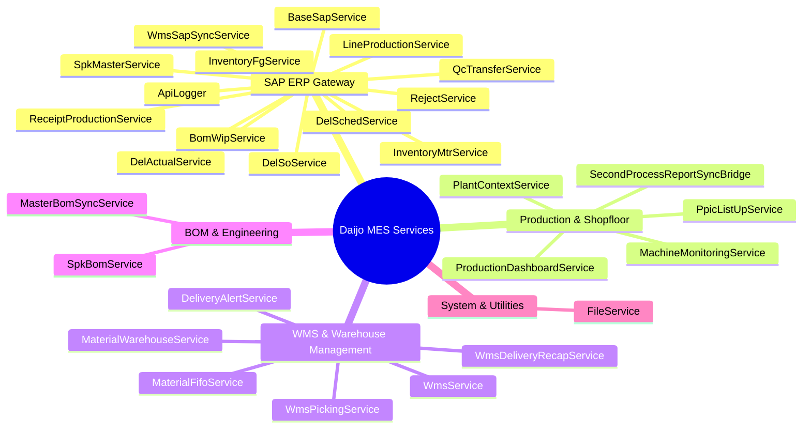

# Daijo MES - Services Reference Catalog

Dokumentasi lengkap seluruh 28 service pada direktori [`app/Services/`](file:///home/andreas/projects/Daijo_MES/app/Services/).

---

## Ringkasan Layanan per Domain

---

## 1. Domain SAP ERP Gateway

### 1.1 `BaseSapService`
- **File**: [`app/Services/BaseSapService.php`](file:///home/andreas/projects/Daijo_MES/app/Services/BaseSapService.php)
- **Peran**: Gateway inti penghubung antara MES dan SAP Business One REST API.
- **Fitur Utama**:
  - `getToken()`: Lazy loading token dengan perlindungan `Cache::lock('sap_token_lock', 40)` untuk mencegah tabrakan autentikasi multi-thread (cache stampede).
  - `authenticate()`: Request Bearer token ke `/auth/token` menggunakan credentials `config('services.sap.*')`.
  - `get($endpoint, $params)` & `post($endpoint, $payload)`: Eksekusi HTTP request dengan timeout 120s, connect timeout 15s, retry 2x, serta auto-refresh token instan bila menerima status HTTP 401.
  - `saveApiLog()`: Menyimpan jejak audit ke tabel `api_logs`.

### 1.2 `ReceiptProductionService`
- **File**: [`app/Services/ReceiptProductionService.php`](file:///home/andreas/projects/Daijo_MES/app/Services/ReceiptProductionService.php)
- **Inherits**: `BaseSapService`
- **Endpoint SAP**: `POST /api/receipt_production/create`
- **Peran**: Mengirimkan tanda terima produksi barang jadi (FG) hasil scan box shopfloor ke SAP.
- **Tabel Terkait**: `production_summary`, `production_scanned_data`, `api_logs`.
- **Mekanisme Kunci**:
  - Mengambil data dari `production_summary` dengan `sap_sent = 0` dan warehouse `FFI` / `KRFFI`.
  - Status lock: `sap_sent = 2` (Processing). Jika SAP sukses atau mengembalikan pesan duplicate, status diubah ke `1` (Success). Jika gagal, status menjadi `3` (Failed).

### 1.3 `QcTransferService`
- **File**: [`app/Services/QcTransferService.php`](file:///home/andreas/projects/Daijo_MES/app/Services/QcTransferService.php)
- **Inherits**: `BaseSapService`
- **Endpoint SAP**: `POST /api/inventory_transfer/create`
- **Peran**: Menangani perpindahan stok hasil inspeksi QC (Quality Control) per box atau per summary.
- **Tabel Terkait**: `qc_transfer_logs`, `production_scanned_data`, `production_summary`.
- **Aturan Alur Gudang**:
  - **KBN**: Barang OK tetap di gudang asal (tidak ditransfer ke SAP), sedangkan barang NG (Reject) ditransfer ke `RJCT`.
  - **Karawang**: Barang OK ditransfer ke `KRFG`, sedangkan barang NG ditransfer ke `KRRJCT`.

### 1.4 `WmsSapSyncService`
- **File**: [`app/Services/WmsSapSyncService.php`](file:///home/andreas/projects/Daijo_MES/app/Services/WmsSapSyncService.php)
- **Inherits**: `BaseSapService`
- **Endpoint SAP**: `POST /api/inventory_transfer/create`
- **Peran**: Menangani perpindahan inventory pallet dari staging area produksi (`FFI`) ke gudang utama Finished Goods (`FG`).
- **Tabel Terkait**: `wms_pallet_forms`, `wms_pallet_form_details`, `spk_item_histories`.

### 1.5 `SpkMasterService`
- **File**: [`app/Services/SpkMasterService.php`](file:///home/andreas/projects/Daijo_MES/app/Services/SpkMasterService.php)
- **Inherits**: `BaseSapService`
- **Endpoint SAP**: `GET /api/sap_production_order/list`
- **Peran**: Menarik daftar SPK / Production Order dari SAP dan menyinkronkannya ke `spk_masters`.
- **Fitur Kunci**:
  - Mendeteksi perubahan SPK Baru (`NEW`), Perubahan Qty Planned/Completed (`QTY_CHANGE`), atau Status (`STATUS_CHANGE`).
  - Mencatat histori perubahan ke tabel `spk_change_logs`.

### 1.6 `DelSoService`
- **File**: [`app/Services/DelSoService.php`](file:///home/andreas/projects/Daijo_MES/app/Services/DelSoService.php)
- **Inherits**: `BaseSapService`
- **Endpoint SAP**: `GET /api/sap_del_so/list`
- **Peran**: Mengambil data Delivery Sales Order aktif dan menyimpannya di tabel `sap_delso`.

### 1.7 `DelSchedService`
- **File**: [`app/Services/DelSchedService.php`](file:///home/andreas/projects/Daijo_MES/app/Services/DelSchedService.php)
- **Inherits**: `BaseSapService`
- **Endpoint SAP**: `GET /api/sap_del_sched/list`
- **Peran**: Mengambil jadwal delivery harian dari SAP dan memperbarui tabel `sap_delsched`.

### 1.8 `DelActualService`
- **File**: [`app/Services/DelActualService.php`](file:///home/andreas/projects/Daijo_MES/app/Services/DelActualService.php)
- **Inherits**: `BaseSapService`
- **Endpoint SAP**: `GET /api/sap_del_actual/list`
- **Peran**: Mengambil riwayat aktual pengiriman barang dari SAP ke tabel `sap_delactual`.

### 1.9 `BomWipService`
- **File**: [`app/Services/BomWipService.php`](file:///home/andreas/projects/Daijo_MES/app/Services/BomWipService.php)
- **Inherits**: `BaseSapService`
- **Endpoint SAP**: `/api/sap_bom_wip/list`, `_semi/list`, `_semi_semi/list`
- **Peran**: Menggabungkan pohon multilevel BOM WIP (Semi 1, Semi 2, Semi 3) dan menyinkronkan ke tabel `sap_bom_wip`.

### 1.10 `InventoryMtrService`
- **File**: [`app/Services/InventoryMtrService.php`](file:///home/andreas/projects/Daijo_MES/app/Services/InventoryMtrService.php)
- **Inherits**: `BaseSapService`
- **Endpoint SAP**: `/api/sap_inventory_mtr/list*`
- **Peran**: Menarik saldo stok raw material, komponen, on-hand, dan vendor info ke tabel `sap_inventory_mtr`.

### 1.11 `InventoryFgService`
- **File**: [`app/Services/InventoryFgService.php`](file:///home/andreas/projects/Daijo_MES/app/Services/InventoryFgService.php)
- **Inherits**: `BaseSapService`
- **Endpoint SAP**: `/api/sap_inventory_fg/list*`
- **Peran**: Mengambil saldo stok Finished Goods, safety stock, daily limit, setup time, cavity, dan parameter cetakan ke tabel `sap_inventory_fg`.

### 1.12 `LineProductionService`
- **File**: [`app/Services/LineProductionService.php`](file:///home/andreas/projects/Daijo_MES/app/Services/LineProductionService.php)
- **Inherits**: `BaseSapService`
- **Endpoint SAP**: `/api/sap_lineproduction/list*`
- **Peran**: Mengambil alokasi lini produksi dan prioritas mesin per part number ke tabel `sap_lineproduction`.

### 1.13 `RejectService`
- **File**: [`app/Services/RejectService.php`](file:///home/andreas/projects/Daijo_MES/app/Services/RejectService.php)
- **Inherits**: `BaseSapService`
- **Endpoint SAP**: `/api/sap_reject/list`
- **Peran**: Mengambil saldo stok gudang reject (`RJCT`, `RJCTEX`) ke tabel `sap_reject`.

### 1.14 `ApiLogger`
- **File**: [`app/Services/ApiLogger.php`](file:///home/andreas/projects/Daijo_MES/app/Services/ApiLogger.php)
- **Peran**: Utility ringkas untuk merekam log API ke tabel `api_logs`.

---

## 2. Domain Production & Shopfloor

### 2.1 `ProductionDashboardService`
- **File**: [`app/Services/ProductionDashboardService.php`](file:///home/andreas/projects/Daijo_MES/app/Services/ProductionDashboardService.php)
- **Peran**: Engine analitik komprehensif untuk dashboard produksi harian/mingguan.
- **Fitur Kunci**:
  - Menghitung efisiensi mesin, cycle time, target vs aktual, persentase NG.
  - Penanganan jadwal shift normal vs setengah hari (Sabtu/Minggu).
  - Distribusi multi-adjuster NG menggunakan integer division dan alokasi remainder.
  - Pengelompokan NG breakdown per model dan remark produksi/NG.

### 2.2 `MachineMonitoringService`
- **File**: [`app/Services/MachineMonitoringService.php`](file:///home/andreas/projects/Daijo_MES/app/Services/MachineMonitoringService.php)
- **Peran**: Memantau status aktif mesin, cycle time sensor, histori breakdown, dan downtime secara real-time.

### 2.3 `PlantContextService`
- **File**: [`app/Services/PlantContextService.php`](file:///home/andreas/projects/Daijo_MES/app/Services/PlantContextService.php)
- **Peran**: Mengelola konteks pabrik (Pabrik Karawang vs Pabrik KBN) untuk memfilter otorisasi operator/adjuster mesin dan konfigurasi shift.

### 2.4 `PpicListUpService`
- **File**: [`app/Services/PpicListUpService.php`](file:///home/andreas/projects/Daijo_MES/app/Services/PpicListUpService.php)
- **Peran**: Perhitungan perencanaan kapasitas produksi harian untuk departemen PPIC berdasarkan jadwal mesin dan target delivery.

### 2.5 `SecondProcessReportSyncBridge`
- **File**: [`app/Services/SecondProcessReportSyncBridge.php`](file:///home/andreas/projects/Daijo_MES/app/Services/SecondProcessReportSyncBridge.php)
- **Peran**: Jembatan sinkronisasi data sesi produksi modern (`SpProductionSession`) ke skema pelaporan `SecondProcessReport` lawas untuk menjaga integritas data historis.

---

## 3. Domain WMS & Warehouse Management

### 3.1 `WmsService`
- **File**: [`app/Services/WmsService.php`](file:///home/andreas/projects/Daijo_MES/app/Services/WmsService.php)
- **Peran**: Layanan logika WMS utama:
  - `recommendPosition()`: Algoritma rekomendasi rak pintar untuk pallet putaway (prioritas konsolidasi slot PARTIAL, rak Level 1 untuk part berat/prioritas, atau slot EMPTY khusus pelanggan).
  - Validasi penempatan posisi dan kapasitas rak.

### 3.2 `WmsDeliveryRecapService`
- **File**: [`app/Services/WmsDeliveryRecapService.php`](file:///home/andreas/projects/Daijo_MES/app/Services/WmsDeliveryRecapService.php)
- **Peran**: Rekapitulasi delivery harian dengan batas cutoff pukul 07:30 WIB (Shift 3 bergulir hingga 07:29:59 pagi berikutnya). Mengelompokkan berdasarkan Item Code, Pallet, dan log box scan.

### 3.3 `WmsPickingService`
- **File**: [`app/Services/WmsPickingService.php`](file:///home/andreas/projects/Daijo_MES/app/Services/WmsPickingService.php)
- **Peran**: Menghitung rute terpendek (*Shortest Path Pick Locations*) dari denah 2D rak gudang ke pintu keluar (Exit Gate) untuk efisiensi picker.

### 3.4 `MaterialFifoService`
- **File**: [`app/Services/MaterialFifoService.php`](file:///home/andreas/projects/Daijo_MES/app/Services/MaterialFifoService.php)
- **Peran**: Validasi dan penegakan aturan First-In First-Out (FIFO) pada pengambilan material/komponen dari gudang raw material.

### 3.5 `MaterialWarehouseService`
- **File**: [`app/Services/MaterialWarehouseService.php`](file:///home/andreas/projects/Daijo_MES/app/Services/MaterialWarehouseService.php)
- **Peran**: Mengelola transaksi keluar-masuk material, pencatatan batch lot bahan kimia/cat, dan stock audit harian.

### 3.6 `DeliveryAlertService`
- **File**: [`app/Services/DeliveryAlertService.php`](file:///home/andreas/projects/Daijo_MES/app/Services/DeliveryAlertService.php)
- **Peran**: Evaluasi jadwal delivery yang tertunda atau mendekati batas waktu untuk memicu peringatan notifikasi.

---

## 4. Domain BOM & Engineering

### 4.1 `MasterBomSyncService`
- **File**: [`app/Services/MasterBomSyncService.php`](file:///home/andreas/projects/Daijo_MES/app/Services/MasterBomSyncService.php)
- **Peran**: Pembersihan (cleansing) data mentah dari staging `master_boms` ke 2 tabel produksi resmi:
  - `master_bom_fg_headers`: Header Finished Goods sah.
  - `master_bom_components`: Struktur hierarki bertingkat WIP dan Raw Material.
  - Mendeteksi anomali folder dummy SAP (misal header proyek grouping).

### 4.2 `SpkBomService`
- **File**: [`app/Services/SpkBomService.php`](file:///home/andreas/projects/Daijo_MES/app/Services/SpkBomService.php)
- **Peran**: 
  - `getLeafMaterials()`: Mengurai komponen leaf (non-WIP / raw material langsung) yang dibutuhkan untuk kuantitas rencana pada SPK tertentu.
  - Melacak log pergantian material / perubahan BOM per nomor SPK di `spk_bom_change_logs`.

---

## 5. Domain Utilities

### 5.1 `FileService`
- **File**: [`app/Services/FileService.php`](file:///home/andreas/projects/Daijo_MES/app/Services/FileService.php)
- **Peran**: Abstraksi penyimpanan berkas, upload dokumen pendukung, dan sanitasi nama file.
